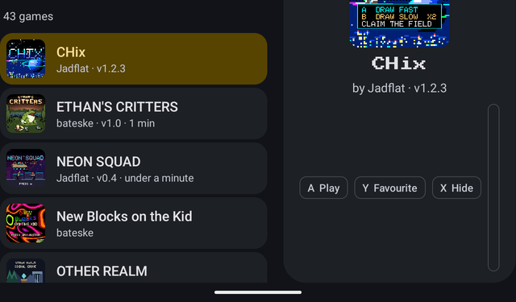
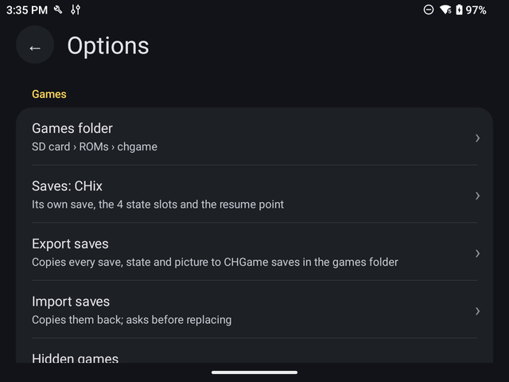

# Playing CHGame games on a Retroid Pocket

This guide covers playing CHGame `.CHG` games on an Android handheld such as the Retroid Pocket
Nova, with the **CHGame Player** app, alone or started from the ES-DE game list:

| | What it is | Best for |
|---|---|---|
| **A. CHGame Player** | a small app of its own (`CHGamePlayer-0.62.apk`) | the simplest setup |
| **B. ES-DE** | a game-list front end that starts the app for you | one menu for every system you play |

The RetroArch (libretro) core for the same emulator is a separate project:
https://github.com/jadflat/CHGame-libretro. Its saves and the app's are kept apart: a game saved in one isn't seen by the
other (a game's save can be exported and imported between them, see *Saves and the SD card*).

---

## What goes where: the files

Release file:

| File | For |
|---|---|
| `CHGamePlayer-0.62.apk` | A, and B |
| `frontends/es_systems.xml`, `frontends/es_find_rules.xml` | B |

Your games:
- **`.CHG`**: a game, for example `Starlift.CHG` or `CHix.CHG`.
- **`.DAT`**: data a game reads from the SD card, for example `STARLIFT.DAT`. Only some games
  have one, and a game that needs one won't start properly without it. STARLIFT shows
  *NEED STARLIFT.DAT*.

Getting files onto the Retroid: a USB cable to the PC (choose *File transfer* on the Retroid),
a microSD card, or any file-sharing app you already use. The Retroid's internal storage is
`/storage/emulated/0/`; file managers usually call it *Internal storage*.

---

## A. CHGame Player (the app)

### Install
1. Copy `CHGamePlayer-0.62.apk` to the Retroid, for example into `Download`.
2. Open it in the Retroid's file manager. The first time, Android asks you to allow installs
   from that file manager: allow it, go back, and tap the APK again. Then tap **Install**.
3. *CHGame* now appears with your apps.

The app asks for one permission, internet, used only by Get games to download free games. It has no storage permission and sees only the one folder you
give it.

### Set up your games folder
1. Make a folder for CHGame games, for example `/storage/emulated/0/ROMs/chgame`. If you'll
   use ES-DE (part B), use exactly that folder: ES-DE expects it there.
2. Copy your `.CHG` files **and** any `.DAT` files into it. `.DAT` files go at the top of the
   folder, not in a subfolder, the same as on the root of a real CHGame card.
3. Open CHGame Player. The first time it asks for your games folder: press **Choose folder**,
   find the folder in Android's picker, open it, and press **Use this folder**, then **Allow**.

The list's sections, from the top:
- **★ Favourites**: the games you've starred (Y);
- **Last played**: the game you played last;
- **CHGame originals**: games made for the CHGame;
- **Ports**: games brought over from PICO-8, the Pokitto or the arcade (a port says so inside its `.CHG`).

A game in Favourites or Last played is in its own section too. Each game shows its play
time, and the right-hand panel shows the total and when you last played it. Only time
actually spent in the game counts, not time paused in a menu.
It shows your games as cards: each game's **cartridge picture** (the same 128x128
picture the CHGame's visual SD menu shows, read from inside the `.CHG`), its **title**, and
its author and version, sorted by title. A file without a title shows its file name, and a
game packed without a picture shows a grey square. The selected game is highlighted in
yellow and shown large on the right, with its full credits. A port shows a tag such as
**PICO-8 port, ported by Jadflat** (or **Pokitto port** for Space Cab), read from the `.CHG`
itself.

**Live preview:** rest on a game for a moment and its picture turns into the game itself,
running with its sound, like an arcade's attract mode. It stops as soon as you move on. The
picture stays until the game has drawn its first screen, so there is no white flash. The
preview starts the game as if for the first time, without your save (with a save, a game such
as Another World would sit on its continue screen), and never changes your save. The
speaker button at the top of the list (or **L1**) mutes or unmutes it; *Options → Live
preview* also sets *Video and sound* (the default), *Video only* or *Off*.

| On a pad | On the touchscreen | |
|---|---|---|
| D-pad | swipe | move through the list |
| A or START | tap the selected game | play |
| Y | long press → *Add to favourites* | star the game (and again to unstar it) |
| X | long press → *Hide* | hide the game (and again to show it) |
| SELECT | the ⚙ gear | Options |

The app also searches subfolders, up to 4 levels deep, so a copy of a whole CHGame SD card
works too. To change the folder later: *Options → Games folder*. The app then gives up its
access to the old one.

### Resume where you left off
When you leave a game (*Quit to game list*, the home button, or switching apps), the app
saves a **resume point**. The next time you start that game it asks:
*Continue where you left off* (with the time it was saved) or *Start from the beginning*.
*Options → Resume where you left off* changes this: *Ask each time* (the default), *Always
continue*, or *Off*, which always starts fresh and writes no resume point. The resume point is
a save state, separate from the 4 save-state slots and from the game's own save.

### Hiding games
Select a game and press **X** (or long-press it and choose *Hide*) to hide it from the list;
do the same to show it again. *Options → Hidden games* shows hidden games, marked
*Hidden* and dimmed, and *Show all hidden games again* clears the list. Hiding only affects the list:
nothing is deleted.

### Quitting from ES-DE
Hold **M2** and press **START** (Retroid Pocket) to quit a game. A game started from ES-DE goes
straight back to ES-DE; one started from the app's list goes back to the list.

### ES-DE: names and descriptions
`tools/esde_gamelist.py` writes ES-DE's `gamelists/chgame/gamelist.xml` from the games' own
`.CHG` files: each game's name, developer, publisher and description (ports say what they were
ported from), keeping what ES-DE recorded itself (play counts and times). Close ES-DE before
copying it in.

### New in 0.17-0.18
- **Game settings…** (long-press a game): its own sound style and volume, over Options'.
- **About this game** lists the `.DAT` files the game names and whether each is in your games folder.
- **Options → Screen**: *Look* (sharp pixels or an LCD grid) and *Colours* (as drawn, or softer like the CHGame's panel).
- **Options → ES-DE → Videos show**: the title only, or the title then some play (the maker presses START and A).
- A quick tap of a button always reaches the game (held for 3 frames).

### Options
SELECT on the list (or the ⚙ gear) opens **Options**, laid out like Android's own Settings.
B or BACK goes back to the list.

| Section | Option | |
|---|---|---|
| Game list | Live preview | video and sound, video only, or off |
| Games | Games folder | where your games are; choose another folder |
| | Saves: *the selected game* | its game save, state slots and resume point (below) |
| | Hidden games | show or hide the games you've hidden; *Show all hidden games again* |
| Playing | Resume where you left off | ask each time, always continue, or off |
| | Picture size | *sharp*: the largest whole-number scale (7x on a 1280x960 screen), every pixel the same size; or *fill the screen height* (slightly larger, pixels a little uneven) |
| Sound | Sound | *Bare pin*, the buzzer pin's signal and the emulator's default, or *Piezo*, imitating the CHGame's small speaker |
| | Volume | 20% to 150%; default 50% |
| ES-DE | ES-DE media folder | where to put videos, screenshots and covers: choose `ES-DE/downloaded_media` |
| | Make videos, screenshots and covers | for every game (or the selected one), see part B |
| Controls | Map buttons | see below |
| About | | version and credits |

### Play
- Choose a game with the d-pad; start it with A or START.
- **In a game, BACK** (or the home/guide button on a pad, or a tap on the screen) pauses and
  opens the menu: *Resume*, *Save state…*, *Load state…*, *Save screenshot*, *Quit to game list*.
  *Save screenshot* writes the screen as a sharp 512x512 PNG into a `screenshots` folder in
  your games folder.
- **Hold R1** to fast-forward (3x; the sound plays at normal pitch but skips). *Options → Map
  buttons* can move it to another button.
- **Hold L2** to rewind, half a second a step, up to about 10 seconds back. *Options → Map
  buttons* can move it.
- In the list, **L2 / R2** jump to the previous or next letter, and **R3** or the 🔍 searches by
  name. *Options → Sort games* sorts by name, most played or recently added.
- **Long-press a game** in the list for: Play, favourite, Hide, Saves, and **About this game**
  (full credits, version, port, description, licence, file and play time). Save and load
  offer 4 slots per game, each showing when it was saved.

| CHGame button | Retroid |
|---|---|
| D-pad | d-pad or left stick |
| A | the **right** face button |
| B | the **bottom** face button |
| START / SELECT | START / SELECT |
| Up (a second button for it) | Y, the left face button |

**Options → Map buttons** changes this: choose a CHGame button (Up, Down, Left,
Right, A, B, START, SELECT) or one of the extras (*Menu*, the key that opens the in-game menu;
*Fast-forward*; *Up (second button)*), then press the Retroid button you want for it. The extras
can also be left on *No key*. *Reset to defaults* puts it all back. The left stick always works as
the d-pad, and BACK always opens the menu, so a mapping can't lock you out.

The picture is drawn at the largest whole-number size that fits: 7x (896 pixels) on a
1280x960 screen, with sharp pixels and black borders.

### Saves and the SD card
- **Game saves**: a game's own saves, written to the CHGame's flash. They're kept inside the
  app and survive closing it.
- **Save states**: 4 slots per game, from the in-game menu.
- **The Saves page:** long-press a game and choose *Saves…* (or *Options → Saves: the game*).
  It has two sections:
  - **Game save**: when the game last saved and its size; *Export to the games folder*
    (writes `<game>.sav` next to your games, to back it up or move it to RetroArch, which uses
    the same format); *Import from the games folder* (takes a `.sav` from the top of the folder
    or its `saves` subfolder, asking before it replaces one); *Delete the game save*.
  - **Save states**: slots 1 to 4 and the resume point, each with when it was saved; press one
    to delete it (you're asked first), or *Delete all states and the resume point*. Saving and
    loading states is done in the game, from its BACK menu.
  `.sav` and `.state` files in your folder aren't copied onto the emulated SD card.
- **The SD card:** when a game starts, the app copies the `.DAT` files (everything except the
  `.CHG` games) from your folder into its own private SD card. When you leave the game, it
  copies back any file the game changed or created. It never deletes anything in your folder.
- **Uninstalling the app deletes its saves and states.** Updating it (installing a newer APK
  over it) keeps them.

### Updating
Install the newer APK over the old one. Android only accepts an update signed with the same
key, which stays on the PC where the app was built.

---

## B. ES-DE (full setup)

ES-DE shows your games in one menu with artwork and starts the right emulator. It starts CHGame games with the app (A) or, if you also install the separate
[RetroArch core](https://github.com/jadflat/CHGame-libretro), with RetroArch, and you can switch between them.
Before starting, set up the app (A) and check that a game starts from it directly.

### 1. Install ES-DE
ES-DE for Android is sold through the developer's **Patreon** (<https://www.patreon.com/es_de>),
the **Samsung Galaxy Store** and the **Huawei AppGallery**. It isn't on Google Play. Install the
APK.

### 2. First start (the configurator)
On the first start, ES-DE's configurator asks for two folders:
1. **The ES-DE folder:** keep the default, `/storage/emulated/0/ES-DE`.
2. **The ROMs folder:** keep the default, `/storage/emulated/0/ROMs`. If you choose a microSD
   card instead, make the `ROMs` folder there yourself first.

Allow the storage access ES-DE asks for. If ES-DE then says there are no games, that's fine
for now.

### 3. Put the games in place
1. In the ROMs folder, make a folder named **`chgame`**: `/storage/emulated/0/ROMs/chgame`.
2. Copy your `.CHG` games into it.
3. Where the `.DAT` files go depends on the emulator:
   - **App (A):** in the same `ROMs/chgame` folder, and in the app choose it as the games folder (*Options → Games folder*)
     and pick `ROMs/chgame`. Do this once. ES-DE lists only the `.CHG` files, so the `.DAT`
     files don't show up as games.
   - **RetroArch (the core):** in `/storage/emulated/0/RetroArch/system/chgame/sdcard/`, as the core's guide says.
   - **Both:** put a copy in each place.

### 4. Tell ES-DE about CHGame
ES-DE doesn't know CHGame, so add it as a custom system:

1. Open the folder `/storage/emulated/0/ES-DE/custom_systems/`.
2. Copy both files from this project's `frontends/` folder into it:
   - **`es_systems.xml`** adds the *CHGame* system for `ROMs/chgame`, with two launch commands:
     *CHGame Player (Standalone)*, the default, and *CHGame (RetroArch)*.
   - **`es_find_rules.xml`** tells ES-DE where the CHGame Player app is. RetroArch needs no
     rule here, because ES-DE already knows it.

   **If either file already exists there**, because you've customised ES-DE before, don't
   replace it. Open both files in a text editor and paste our `<system>…</system>` block
   inside your `<systemList>`, or our `<emulator>…</emulator>` block inside your `<ruleList>`.
3. **Restart ES-DE completely:** force-stop it in Android's settings (Apps → ES-DE → Force
   stop) and open it again. ES-DE reads these files only when it starts.

**CHGame** now appears among the systems. Most themes have no CHGame artwork, so it may show
just the name or a plain card.

What the launch commands do:
- **CHGame Player:** `%EMULATOR_CHGAME-PLAYER% %ACTION%=android.intent.action.VIEW
  %DATA%=%ROMPROVIDER%` hands the app that one game file, with read permission for this launch
  only (ES-DE's FileProvider route). The app copies it in and starts it. In the game, BACK →
  *Quit* takes you back to ES-DE.
- **RetroArch:** RetroArch is started with the full path to the installed core,
  `/data/user/0/com.retroarch.aarch64/cores/chgame_libretro_android.so`, the way ES-DE starts
  all its RetroArch systems on Android. Quit through RetroArch's menu (**Quick Menu → Close
  Content**, then **Quit RetroArch**, or your exit hotkey).

### 5. Choose the emulator
- **For all CHGame games:** ES-DE main menu (START) → **Other settings → Alternative
  emulators**, pick *CHGame*, then the command you want.
- **For one game:** select the game, press SELECT for its game options, choose **Edit this game's metadata**,
  and set **Alternative emulator**.

Without either setting, *CHGame Player (Standalone)* is used.

### 6. Artwork and videos (optional)
ES-DE's scraper won't find CHGame games: ScreenScraper has no CHGame system. **CHGame Player
makes them for you:** *Options → ES-DE media folder*, choose `ES-DE/downloaded_media`, then
*Make videos, screenshots and covers*. For each game it runs the game on the Retroid (faster
than real time, from a clean start) and writes a 15-second video with sound (512x512, sharp
pixels), a screenshot and the cart picture as the cover, into `downloaded_media/chgame/videos`,
`screenshots` and `covers`. Restart ES-DE to see them. You can also add pictures yourself,
named exactly like the game file without `.CHG`:

    /storage/emulated/0/ES-DE/downloaded_media/chgame/screenshots/Starlift.png
    /storage/emulated/0/ES-DE/downloaded_media/chgame/covers/Starlift.png

Restart ES-DE afterwards.

### 7. If it doesn't work
| What you see | Likely cause |
|---|---|
| No *CHGame* system | the XML files aren't in `ES-DE/custom_systems/`, ES-DE wasn't restarted, `ROMs/chgame` has no `.CHG` files, or a file was pasted in wrong. Check the end of `ES-DE/logs/es_log.txt` |
| "Couldn't find emulator" for CHGame Player | `es_find_rules.xml` is missing or the app isn't installed |
| Black screen or hang with RetroArch | the core isn't installed (see the core's guide); ES-DE can't check for that |
| RetroArch starts but complains about the core | you have the Play Store RetroArch, or the core's file name was changed |
| STARLIFT says *NEED STARLIFT.DAT* (more than a moment) | the `.DAT` isn't where that emulator looks (step 3) |
| The app says "Could not open the game" | ES-DE passed something that isn't a `.CHG` |

---

### RetroArch: making .CHG files show up

RetroArch only lists files whose extension some installed core claims. If **Load Content** shows
no `.CHG` files:

- **PC (Windows, Linux, macOS):** copy `chgame_libretro.info` into RetroArch's `info` folder
  (Windows: `<RetroArch>\info`; Linux: `~/.config/retroarch/cores` or `/usr/share/libretro/info`;
  macOS: `~/Library/Application Support/RetroArch/info`), then restart RetroArch.
- **Any platform, including Android:** turn off **Settings > User Interface > Filter Unknown
  Extensions** (config key `menu_navigation_browser_filter_supported_extensions_enable`).
  Then the file browser shows every file. This is the fix on Android, where the `info` folder is
  private to the app and can't be copied into.
- **Android, installing the core:** copy `chgame_libretro_android.so` to
  `RetroArch/downloads`, then **Main Menu > Load Core > Install or Restore a Core** and pick it.

**Core options** (Quick Menu > Core Options):

| Option | Values |
|---|---|
| `chgame_scale` Internal upscale | 1x to 6x |
| `chgame_sd` microSD card | folder, Image, off |
| `chgame_dat_all` Data files on the card | Off, All .DAT in folder |
| `chgame_cpu` CPU speed (frame rate unchanged) | 100%, 150%, 200%, 300% |
| `chgame_speed_osd` CPU load display | Off, On |
| `chgame_sound` Sound model | bare pin, piezo, Speaker, Soft, Warm, Crisp |
| `chgame_volume` Volume | Off, 25%, 50%, 75%, 100%, 150% |
| `chgame_bass` Bass | Off, Low, High |
| `chgame_lowpass` Low-pass | Off, Light, Strong |
| `chgame_dc_block` DC block | On, Off |
| `chgame_colour` Colour | Raw, LCD |

Rewind, run-ahead and cheats (the 20 KB RAM is exposed as a memory map) work.

---

## Speed

Measured on a Retroid Pocket Nova (CHGame Player's speed line, at 60 frames a second, which is
full speed): STARLIFT takes about 2.5 ms a frame, CHix 2.1 ms and Another World 1.4 ms, out of the
16.7 ms a frame has. The sound on the Nova has been listened to and is good. *Options → Speed
overlay* shows the figures in a game.

## Credits

CHGame Emulator by **joyrider3774** (MIT): all of the emulation.
CHGame by **Kevin Bates** (bateske, https://chgame.website; Apache-2.0); the bootloader embedded in
the emulator is MIT. The game-name font is Press Start 2P by CodeMan38
(SIL OFL 1.1). Each game's makers are credited in the app's *About this game*.
RetroArch and libretro by the libretro team. ES-DE by Leon Styhre. The app
and this guide: jadflat.
