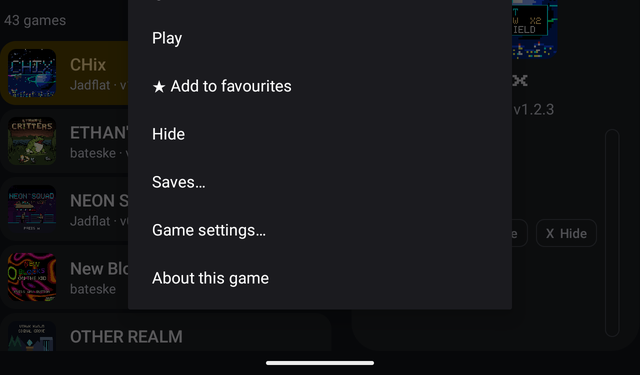
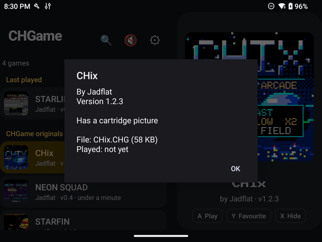
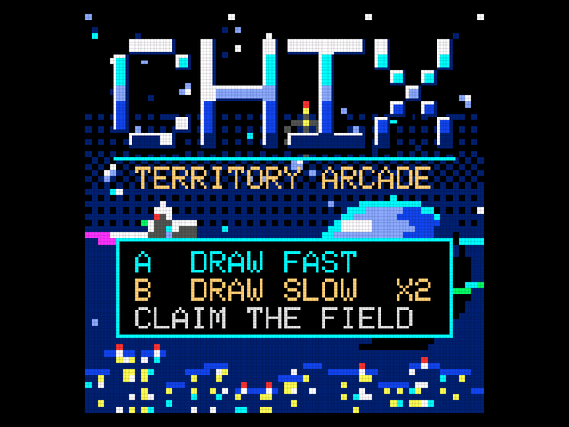
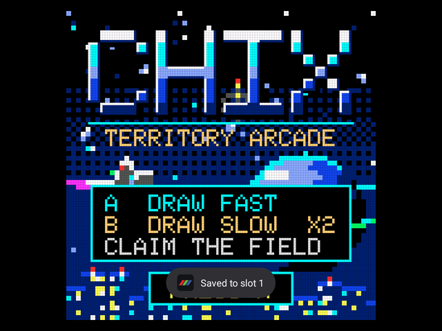
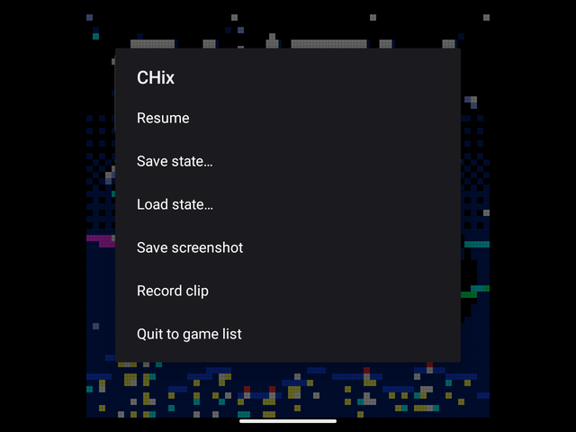
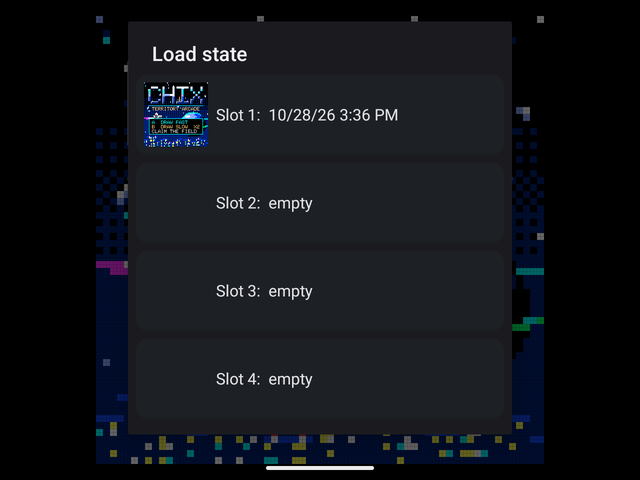
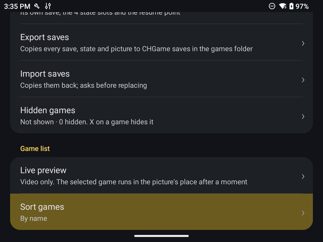
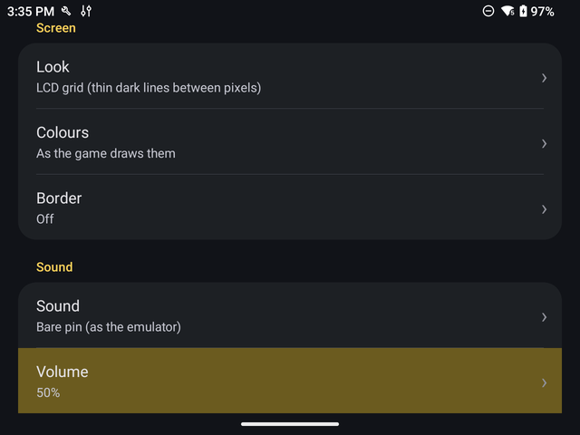

# How to use CHGame Player

A short, illustrated guide to the Android app, with screenshots from a Retroid Pocket Nova. For
installing it, ES-DE and RetroArch, see [GUIDE.md](GUIDE.md).

## 1. First start

1. Install the APK and open **CHGame Player**.
2. Choose your games folder when asked: the folder that holds your `.CHG` games. Put any `.DAT`
   files a game needs (Another World's `ANOTHERW.DAT`, `STARLIFT.DAT`, ...) in the same folder.
3. The list fills with every game it finds, with its cartridge picture.

If no controller is found (on a phone, say), the app offers on-screen touch controls.

## 2. The game list

The selected game plays a live preview on the right, with its sound (L1 mutes it).

| Button | Does |
|---|---|
| D-pad up / down | move through the list |
| D-pad left / right | up / down a page |
| A or START | play |
| Y | add to or remove from ★ Favourites |
| X | hide the game (Options → Hidden games shows them again) |
| L2 / R2 | jump to the previous / next letter |
| R3 or 🔍 | search by name |
| L1 or 🔊 | mute the preview |
| SELECT, Home or ⚙ | Options |

Sections: **★ Favourites**, **Last played**, **CHGame originals** and **Ports**.

**Long-press a game** (on the touch screen) for more: Play, Favourite, Hide, Saves…, Game
settings… and About this game.

**About this game** shows the author, version, credits, licence, play time, and whether the
`.DAT` files it needs are in your folder.

## 3. Playing

| Button | Does |
|---|---|
| D-pad, A, B, START, SELECT | the CHGame's own buttons (A is the right face button, B the bottom one) |
| Y | Up as well, beside the d-pad |
| Hold R1 | fast-forward (3x) |
| Hold L2 | rewind, half a second a step, up to about 10 seconds |
| L1 | screenshot |
| L3 | quick save (slot 1) |
| R3 | quick load (slot 1) |
| BACK or Home | the in-game menu |
| Hold M2 + START | quit (back to ES-DE, if it started the game) |

All of these can be changed in **Options → Map buttons**, which also has a *Test buttons* row.

### The in-game menu

- **Resume**
- **Save state… / Load state…**: 4 slots a game, each with a picture of the moment it was saved.
- **Save screenshot**: a sharp 512×512 PNG.
- **Record clip / Stop clip**: an animated GIF of up to 20 seconds.
- **Quit to game list**: your place is kept; next time the game offers *Continue where you left
  off*.

Screenshots and clips go to a **CHGame screenshots** folder inside your games folder. **Options → Screenshots, clips and pictures** shows them with thumbnails, to share (Android's share sheet), export to a folder you pick, or delete; it also exports save-state pictures and every game's cart picture (512×512), and has *Export all*.

## 4. Options

| Section | What's there |
|---|---|
| Games | the games folder; Saves (a game's own save, its 4 state slots and resume point); **Export saves** / **Import saves** (to and from a *CHGame saves* folder in your games folder; import asks before replacing anything); Hidden games |
| Game list | Layout (a list, or a grid of big cart pictures); Live preview (sound, video only or off); Sort games (name, most played, recently added) |
| Playing | Resume (ask, always, or off); Picture size (sharp whole-number scaling or fill the screen); Speed overlay (fps, % of real speed, frame time) |
| Screen | Look (sharp, an LCD grid, scanlines, or CRT); Colours; Border (a CHGame-shaped frame beside the picture) |
| Sound | Sound (bare pin or piezo-like); Volume; Audio buffer |
| Controls | Map buttons; Touch controls (off, automatic or always) |
| ES-DE | checks which games are missing a video, screenshot or cover, lists them, and makes the ones you tick |

**Per-game settings**: long-press a game → *Game settings…* for its own sound, volume and button
map; anything not set there uses the main Options.

## 5. Saves and the SD card

- A game's own saves (high scores, progress) are kept inside the app, like the CHGame's flash.
- Save states are snapshots you can load at any moment; the resume point is written when you quit.
- **Options → Export saves** copies all of them to *CHGame saves* in your games folder: copy that
  folder to keep a backup or move to another device, then **Import saves** there.
- Games that read the SD card (`.DAT` files) find them in your games folder. If one is missing,
  the app says so before the game starts, with *Start anyway*.

## 6. If something goes wrong

- **A game won't start, or says a file is missing**: check About this game for its `.DAT` files.
- **The game stops responding**: after 3 seconds the app offers *Reset* (starts the game fresh)
  or *Quit*.
- **Sound crackles**: Options → Sound → Audio buffer → *High*.
- **A button does the wrong thing**: Options → Map buttons → *Test buttons*, or *Reset to
  defaults*.
